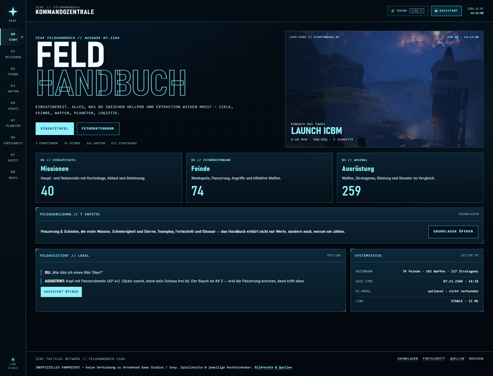
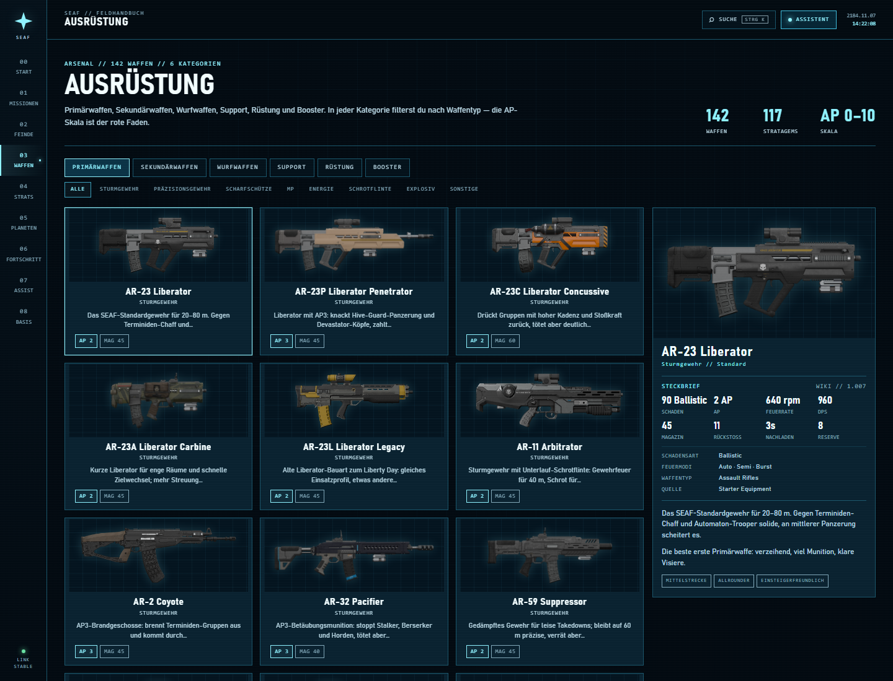
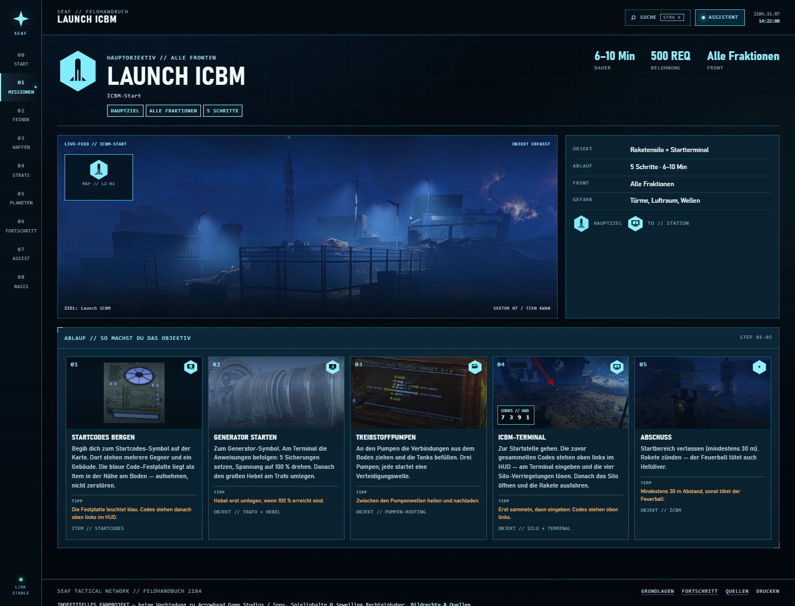
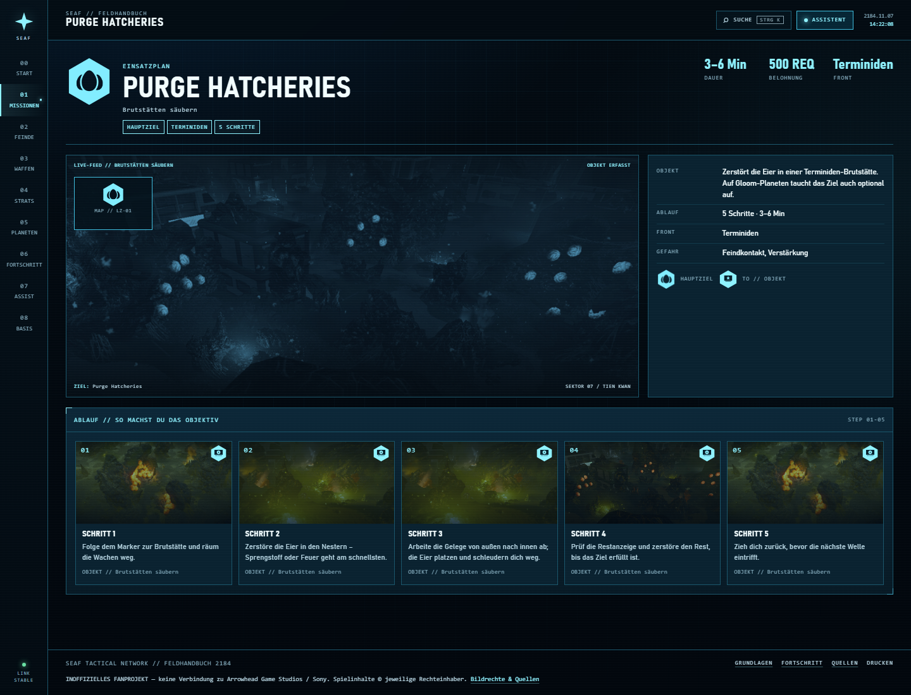

# SEAF Feldhandbuch — Blue Terminal

**Inoffizielles Fan-Projekt.** Keine Verbindung zu Arrowhead Game Studios oder
Sony. Spielinhalte und Bilder gehören den jeweiligen Rechteinhabern; Details in
[COPYRIGHT.md](COPYRIGHT.md).

Ein Einsteiger-Handbuch zu **Helldivers 2** als eigenständige Website: Missionen
mit konkreten Objektiv-Schritten, Feinde mit Weakspots und Panzerung, Waffen,
Stratagems, Planeten-Effekte, Fortschritt und ein Assistent, der im Handbuch
sucht — offline oder mit KI-Modell.

Kein Build-Schritt, keine Datenbank, keine Framework-Installation. Ein
Node-Server liefert die Seite aus und kann optional als KI-Proxy dienen.



## Starten

Voraussetzung: **Node.js 18 oder neuer** (getestet mit Node 24).

```bat
start.cmd
```

oder direkt:

```bat
node server.mjs
```

Der Browser öffnet `http://127.0.0.1:4173`. Anderer Port:

```bat
set PORT=4174 && node server.mjs
```

Ist der Port belegt, probiert der Server automatisch die nächsten Ports
(4174, 4175 …) und öffnet den passenden. Läuft das Feldhandbuch bereits, öffnet
`start.cmd` nur den Browser und beendet sich wieder — es startet keine zweite
Instanz.

`index.html` per Doppelklick zu öffnen funktioniert **nicht** — die Seite lädt ihre
Daten per `fetch`, dafür braucht sie einen HTTP-Server.

## Auf GitHub stellen

**Wichtig:** Die 25-MB-Grenze gilt pro Datei beim **Web-Upload**. Das
fertige ZIP ist ca. 182 MB und wird deshalb vom Browser-Upload abgelehnt.
Das ist kein Repo-Limit: Die größte Einzeldatei im Projekt ist ca. 3,4 MB.
Das ZIP ist nur zum Weitergeben/Entpacken gedacht, **nicht zum Hochladen als
eine Datei**.

### Empfohlen: Git oder GitHub Desktop

Mit installiertem Git (dieses Skript liegt im Projekt):

```bat
publish-to-github.cmd https://github.com/DEIN-NAME/DEIN-REPO.git
```

Das Skript initialisiert das Repo, committet alle Dateien und pusht nach
`main`. Vorher im Browser ein **leeres** Repository anlegen. Bei der
Passwortabfrage einen **Personal Access Token** verwenden, kein Passwort.

Alternativ mit GitHub Desktop: Ordner `hd2-feldhandbuch` als lokales Repository
hinzufügen → „Publish repository“. Das nutzt Git und umgeht den 25-MB-Web-Upload.

Manuell:

```bash
cd hd2-feldhandbuch
git init
git add .
git commit -m "Initial commit"
git branch -M main
git remote add origin https://github.com/DEIN-NAME/DEIN-REPO.git
git push -u origin main
```

### Wenn es unbedingt der Web-Upload sein soll

ZIP entpacken und die **Ordner/Dateien** hochladen — nicht das ZIP. GitHub
akzeptiert maximal 100 Dateien pro Upload und 25 MB pro Einzeldatei. Bei 659
Dateien also in mehreren Paketen hochladen; alle Einzeldateien sind unter 25 MB.

### GitHub Pages

1. Im Repository unter **Settings → Pages → Build and deployment** die Quelle
   **GitHub Actions** wählen.
2. Der Workflow `.github/workflows/pages.yml` veröffentlicht die Seite bei jedem
   Push auf `main` oder `master` automatisch.
3. Die Seite läuft dann unter `https://<name>.github.io/<repo>/`.

Die Seite ist statisch und braucht auf GitHub Pages **keinen Node-Server**.
Der lokale Assistent funktioniert offline; der optionale KI-Proxy aus
`server.mjs` steht auf Pages nicht zur Verfügung. Für KI im Browser kann der
Key im Assistenten hinterlegt werden, sofern der Anbieter CORS erlaubt.

### Nur `publish-to-github.cmd` auf GitHub sichtbar?

Dann wurde entweder nur das Skript hochgeladen oder der Push ist
fehlgeschlagen. Das Skript ist ein **lokales Werkzeug** und muss im entpackten
Ordner mit `index.html`, `assets/` und `data/` liegen — nicht allein
hochgeladen werden.

Prüfe lokal:

```bat
cd hd2-feldhandbuch
dir index.html
git ls-files | find /c /v ""
```

- **Nur 1 Datei:** falscher Ordner oder ZIP nicht vollständig entpackt.
- **Ca. 660 Dateien:** lokal ist alles da, aber der Push wurde abgelehnt.
  Dann ein **leeres** GitHub-Repo anlegen und erneut pushen.
- Auf GitHub müssen sichtbar sein: `index.html`, `assets/`, `data/`,
  `.github/`, `README.md`.

Wenn das Repo schon einen README-Commit hat:

```bat
git pull --rebase origin main
git push -u origin main
```

## Die Bereiche

| Route | Inhalt |
| --- | --- |
| **00 Start** | Kommandozentrale mit Einsatz des Tages, Schnellzugriff und Systemstatus |
| **01 Missionen** | 40 Haupt-, optionale und Event-Ziele. **Alle 182 Schritte** haben ein Bild; **Launch ICBM** zusätzlich fünf konkrete Schritte mit Objektfotos, blauen Kartensymbolen und HUD-Codes |
| **02 Feinde** | 94 Einträge: Terminiden, Automatons, Illuminate, Subfraktionen und Strukturen — mit Weakspots, Panzerung, Angriffen, effektiven Waffen und Taktik |
| **03 Ausrüstung** | Tabs für Primärwaffen, Sekundärwaffen, Wurfwaffen, Support, Rüstung und Booster; Untertabs nach Waffentyp. **Alle 142 Waffen** haben ein Render und einen Steckbrief mit Schaden, AP, Feuerrate, DPS, Magazin, Rückstoß, Nachladen und Reserve |
| **04 Stratagems** | 117 Stratagems mit Icon, Eingabecode, Cooldown, Rolle, Stärken und Schwächen |
| **05 Planeten** | 16 Umweltbedingungen, Operationsmodifikatoren, Subfraktionen und Biome |
| **06 Fortschritt** | Was Schiffmodule sind und wo man sie kauft (mit Terminal-Bild), Stratagem-Quellen, Warbonds und Währungen |
| **07 Assistent** | Lokale Volltextsuche plus optionale KI-Anbindung |
| **08 Grundlagen** | 7 Kapitel Feldausbildung: Spielschleife, Panzerung & Schaden, erste Mission, Schwierigkeit, Teamplay, Fortschritt, Glossar |
| **Quellen** | Wiki-Attribution und Hinweise |



Alle Waffenbilder stammen aus 1200-px-Renders der Wiki, wurden transparent
freigestellt und auf das Motiv zugeschnitten. Die Schrittbilder liegen in
`assets/img/missions/steps/` und werden pro Mission und Schritt zugeordnet.

Dazu: globale Suche (`Strg + K` oder `/`), Tastaturbedienung, responsives Layout
und Druck-Stylesheet.

## Missionen: konkrete Schritte statt Checkliste

Die ICBM-Mission zeigt beispielhaft, wie ein Objektiv wirklich abläuft:

1. **Startcodes bergen** — zum Symbol, Gebäude sichern, blaue Code-Festplatte am Boden aufnehmen.
2. **Generator starten** — am Terminal fünf Sicherungen setzen, Spannung auf 100 %, Hebel am Trafo.
3. **Treibstoffpumpen** — Verbindungen aus dem Boden ziehen, drei Tanks befüllen.
4. **ICBM-Terminal** — die gesammelten Codes stehen **oben links im HUD**, am Terminal eingeben, vier Silo-Verriegelungen lösen.
5. **Abschuss** — 30 m Abstand, Rakete zünden.

Jeder Schritt hat ein **blaues Hexagon-Kartensymbol** (Codes, Generator, Pumpe,
Terminal, Rakete), ein Objektfoto und einen Tipp. Empfohlenes Loadout und
Neben-Ziele-Blöcke gibt es im Missionsdetail bewusst nicht.





Die Symbole liegen als SVG und PNG in `assets/img/objectives/` und lassen sich
auch für weitere Missionen verwenden.

## Blue-Terminal-Design

Dunkles Marineblau, Holo-Cyan, Raster, Scanlines, harte Kanten, Bahnschrift +
Consolas. Die Website ist eine eigenständige Umsetzung; sie lädt keine
FigCraft-Dateien. Die FigCraft-Designquelle und die Board-Exporte sind **nicht
Teil dieses Repositories** — die Website enthält aber die fertigen Screenshots
in `docs/`. Farben und Typografie liegen in `assets/css/terminal.css`.

## KI-Assistent

Der Assistent hat zwei Modi:

1. **Lokal (Standard).** Durchsucht den kompletten Katalog, erkennt Feind-,
   Waffen-, Stratagem-, Missions- und Währungsfragen und antwortet mit
   Quellenlinks. Braucht weder Internet noch API-Key.
2. **KI-Modell (optional).** Ein OpenAI-kompatibles Modell formuliert freie
   Antworten. Der Assistent schickt die passenden Handbuchstellen als Kontext mit.

### Variante A: Key im Browser

Zahnrad im Assistenten → Anbieter wählen → Key eintragen → **Speichern**.
Der Key liegt nur im `localStorage` dieses Browsers. Presets gibt es für OpenAI,
DeepSeek, Groq, OpenRouter, Ollama und LM Studio.

Bei Anbietern, die Browser-Anfragen per CORS blockieren, schlägt der Direktaufruf
fehl; dann Variante B verwenden.

### Variante B: Key auf dem Server (empfohlen)

```bat
copy ai.config.example.json ai.config.json
notepad ai.config.json
```

```json
{
  "baseUrl": "https://api.deepseek.com/v1",
  "model": "deepseek-chat",
  "apiKey": "DEIN_API_KEY",
  "temperature": 0.25
}
```

Danach `start.cmd` neu starten. Der Server prüft die Konfiguration und bietet
`/api/chat` als Proxy an; der Browser sieht den Key nie. `ai.config.json` ist in
`.gitignore` eingetragen und wird nicht mitgeliefert.

Alternativ per Umgebungsvariablen:

```bat
set HD2_AI_BASE_URL=https://api.deepseek.com/v1
set HD2_AI_MODEL=deepseek-chat
set HD2_AI_KEY=sk-...
node server.mjs
```

**Ollama** (lokal): Base-URL `http://localhost:11434/v1`, Modell z. B. `llama3.2`,
Key leer. Für direkte Browser-Aufrufe muss Ollama CORS erlauben
(`OLLAMA_ORIGINS=*`); über den Server-Proxy ist das nicht nötig.

Der Endpunkt `/api/ai/status` zeigt, ob ein Modell konfiguriert ist. Ohne
Konfiguration antwortet `/api/chat` mit HTTP 503 und der Assistent bleibt lokal.

## Projektstruktur

```
hd2-feldhandbuch/
  index.html
  server.mjs                  statischer Server + optionaler KI-Proxy
  start.cmd
  ai.config.example.json
  DATA-SCHEMA.md              Format aller Datendateien
  COPYRIGHT.md                Bildrechte, Wiki-Lizenz und Quellen
  assets/
    css/terminal.css          Blue-Terminal-Design
    js/app.js                 Router, Suche, Navigation
    js/views-blue.js          alle Seitenansichten
    js/core.js                Daten laden, Index, Volltextsuche
    js/assistant.js           lokale Antworten + LLM-Streaming
    icons/                    117 Stratagem-Icons (SVG)
    img/enemies/              Feind-Porträts (120-px-Fallback)
    img/enemies/icons/        hochauflösende Enemy-Icons (1400 px)
    img/enemies/card/         Kartenversionen (400 px)
    img/enemies/hi/           ausgewählte Voll-Renders/Screenshots
    img/missions/             Missionslogos, Objektfotos, Terminalbild
    img/missions/steps/       Bildbibliothek für 182 Missionsschritte
    img/objectives/           blaue Hexagon-Kartensymbole (SVG + PNG)
    img/weapons/              alte Alpha-Renders (Fallback)
    img/weapons/hi/           142 Waffenrender, 1200 px, transparent
  data/
    guide.json                7 Kapitel Grundausbildung
    missions.json             40 Missionsziele
    enemies.json              94 Feinde und Strukturen (inkl. `attacks`)
    weapons.json              142 Waffen
    stratagems.json           117 Stratagems
    armor.json                Passives, Klassen, Sets
    boosters.json             20 Booster
    planets.json              Hazards, Modifier, Biome
    economy.json              Währungen, Warbonds, Ship Modules
  tools/fetch-icons.mjs       lädt die Feind-Porträts neu
  tools/fetch-enemy-icons.mjs holt die 1400-px-Enemy-Icons
  tools/enemy-icon-alpha.py   entfernt Hintergründe der Icons
  tools/enemy-alpha-crop.py   entfernt Hintergründe der Vollbilder
  tools/fetch-enemy-images3.mjs lädt Voll-Renders/Screenshots als Fallback
  tools/enemy-cards.py        erzeugt 400-px-Kartenbilder
  tools/enrich-weapons.mjs    holt Waffenrender + Infobox-Werte
  tools/fix-weapon-images.mjs repariert fehlende Waffenrender
  tools/weapon-alpha.py       entfernt weiße Render-Hintergründe
  tools/weapon-crop.py        schneidet transparente Ränder ab
  tools/fetch-step-images.mjs lädt die Missions-Bildbibliothek
  tools/tint-step-images.py   färbt die Schrittbilder blau ein
  tools/build-step-images.mjs ordnet jedem Schritt ein Bild zu
  docs/                       Screenshots
```

## Daten bearbeiten

Alle Inhalte liegen als JSON in `data/`. Nach dem Speichern reicht ein Reload —
es gibt keinen Build-Schritt. Das erwartete Format steht in
[DATA-SCHEMA.md](DATA-SCHEMA.md).

- Neuer Feind: Objekt in `data/enemies.json` → `enemies[]` ergänzen. Die ID wird
  automatisch zur Route `#/feinde/<id>` und in die Suche aufgenommen. Optional:
  `attacks: [{ name, type, range, danger, desc }]`.
- Neues Stratagem: Eintrag in `data/stratagems.json` mit `icon`-Dateinamen aus
  `assets/icons/`.
- Neue Waffe: `data/weapons.json`; `pen` ist die Panzerungsdurchdringung 1–10
  (2 = leicht, 3 = mittel, 4 = schwer, 5–7 = Panzerabwehr).
- Neuer Planeteneffekt: `data/planets.json`; erscheint automatisch im Kapitel
  Planeten und in der Suche.
- Missionsbilder: `stepImages` in `data/missions.json` (ein Eintrag pro Schritt).
- Waffenbilder: `image` in `data/weapons.json`; die Dateien liegen in
  `assets/img/weapons/hi/`. `damage`, `fireRate`, `dps`, `recoil`, `reload` und
  `spareMags` speisen den Steckbrief.

Feind-Icons neu laden (überschreibt vorhandene Dateien, benötigt Internet):

```bat
node tools/fetch-icons.mjs
```

## Lizenz

- **Quellcode:** MIT, siehe [LICENSE](LICENSE).
- **Spielinhalte und Bilder:** nicht MIT. Rechte bei den jeweiligen
  Rechteinhabern; Wiki-Texte CC BY-NC-SA 4.0. Details in
  [COPYRIGHT.md](COPYRIGHT.md).

## Datenstand & Quellen

Stand **November 2026**. Die Inhalte stammen aus der
[Helldivers Wiki (wiki.gg)](https://helldivers.wiki.gg), aus Spielbeobachtung und
Community-Konsens. **Wiki-Texte** stehen unter **CC BY-NC-SA 4.0**. Die
**Spielbilder** (Renders, Screenshots, Logos, Icons) sind Werke von
**Arrowhead Game Studios / Sony Interactive Entertainment** und bleiben
urheberrechtlich geschützt; die Wiki-Lizenz überträgt sich nicht automatisch auf
diese Assets. Dieses Projekt ist nicht kommerziell und erhebt keinen offiziellen
Anspruch. Details: [COPYRIGHT.md](COPYRIGHT.md).

Das Spiel wird laufend gepatcht. Werte, Warbonds und Gegner können sich ändern;
die Seite erhebt keinen Anspruch auf Vollständigkeit oder Turniergenauigkeit.
Bei wenigen Feinden ist der Panzerungswert geschätzt, wenn die Wiki keine klare
Zahl nennt — das steht dann in `armorNote`.

**Keine Verbindung zu Arrowhead Game Studios, Sony oder der Super-Erde.** Kein
Cheat, kein Overlay, kein Eingriff ins Spiel.

## Bekannte Grenzen

- Deutsche Gegnernamen sind beschreibende Übersetzungen, keine offizielle
  Lokalisierung. Englische Eigennamen bleiben bewusst stehen.
- Das Handbuch zeigt keine Live-Daten vom Galactic War (Planetenstände, Major
  Orders) — dafür ist die Karte im Spiel die richtige Quelle.
- Der lokale Assistent ist eine Suche mit Antwortvorlagen, kein Sprachmodell. Für
  freie Formulierungen braucht er ein KI-Modell.
- Alle 94 Feinde haben ein hochauflösendes Bild: 1400-px-Enemy-Icons, bei
  Bile Titan zusätzlich der große Voll-Render. Die Karten nutzen 400-px-Versionen.
- Alle 142 Waffen haben ein Bild. Zwei Waffen (SMG/FLAM-34 Stoker, P-69 Veto) nutzen
  das offizielle Icon, weil die Wiki keinen separaten Render liefert.
- Alle 182 Missionsschritte haben ein Bild. Bei den meisten Missionen stammt es aus
  der thematischen Bildbibliothek; ICBM nutzt eigene Objektfotos.
- Die Wiki-Werte sind auf Stand 1.007.x; nach einem Patch können einzelne Zahlen
  abweichen.
